<p align="center">
  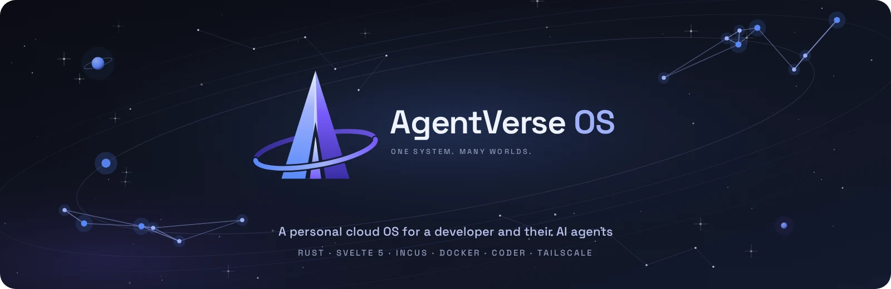
</p>

<p align="center">
  <a href="#quick-start"></a>
  <a href="cloudd/"></a>
  <a href="desktop/"></a>
  <a href="store/"></a>
  <a href="LICENSE"></a>
  
</p>

<p align="center">
  <a href="#the-film">Film</a> ·
  <a href="#in-ten-frames">In ten frames</a> ·
  <a href="#what-it-does">What it does</a> ·
  <a href="#screens">Screens</a> ·
  <a href="#architecture">Architecture</a> ·
  <a href="#quick-start">Quick start</a> ·
  <a href="#status">Status</a>
</p>

**AgentVerse OS** is a personal cloud operating system for a developer and their AI agents: your own cloud running on a single server,
used from any device through the browser. It is built as a cross-platform vibe coding flow: the same desktop, workspaces and agents
open on a laptop, a tablet or a phone, the workspace and its agents stay on the server, and the work continues where you left it.

- **One command** installs it on a clean Ubuntu; everything after that happens in the browser.
- **A container of its own for every project**, with VS Code and six agent engines inside: Claude Code, Codex, Gemini CLI, pi,
  Antigravity CLI and Oh My Pi.
- **A windowed desktop**, a store of 978 self-hosted apps, backups and updates.
- **Nothing is exposed to the internet**: access goes through Tailscale with real certificates, no root CAs to install on your devices.

> The project is in alpha and lives on a single test box. It works as a personal server for one person; there are no user accounts or
> permissions yet. See [Status](#status) for what is done and what is not.

## The film

<p align="center">
  <a href="assets/promo/agentverse-os-promo.mp4">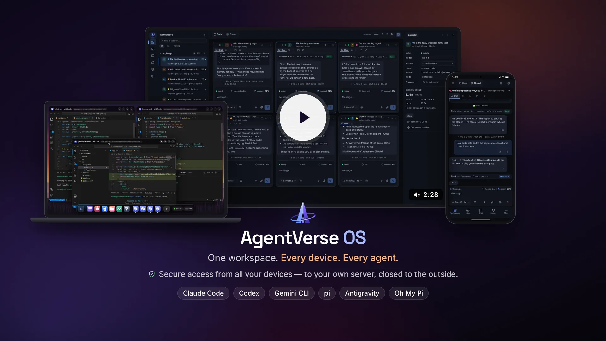</a>
</p>
<p align="center"><sub>▶ <a href="assets/promo/agentverse-os-promo.mp4"><b>Watch the film</b></a> — MP4, 2 min 28 s, 20 MB, English voice-over and music. One day with one workspace: a container for every project instead of a folder, the same desktop on a monitor, a laptop and a phone, six agent engines, voice, several subscriptions in one pool, the Store, and a server that stays closed to the internet. The picture is the real UI; every name and number in it is invented.</sub></p>

## In ten frames

Ten frames of the film and what stands behind each of them.

<table>
  <tr>
    <td width="50%" valign="top">
      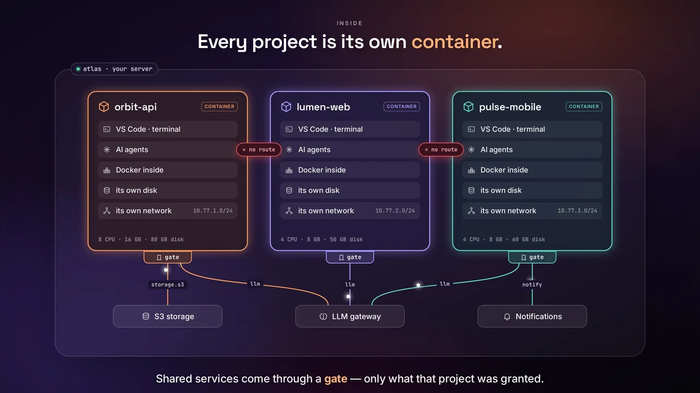
      <p><b>A container for every project.</b> Its own system, network, disk and limits — an agent cannot reach the project next door.</p>
    </td>
    <td width="50%" valign="top">
      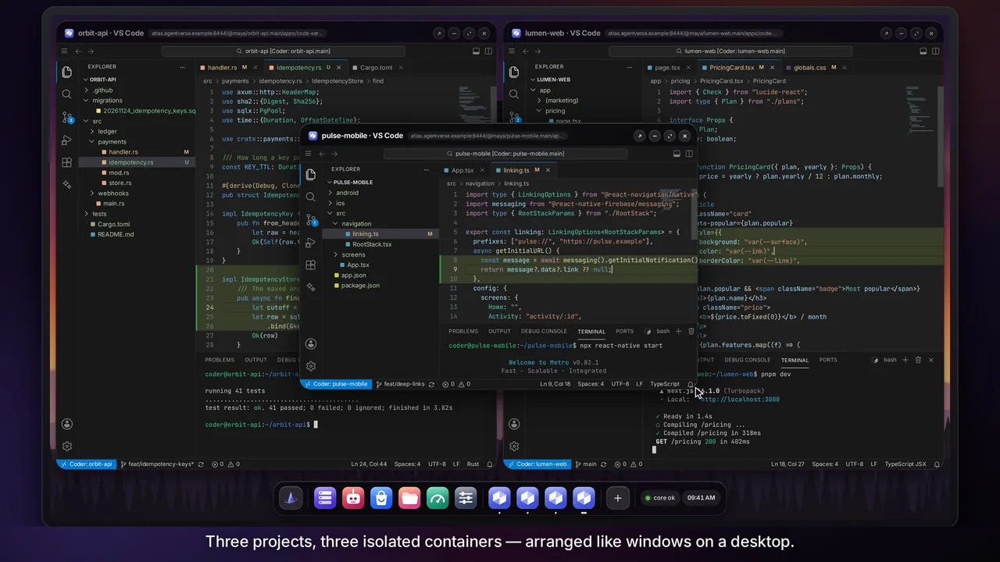
      <p><b>A desktop in a browser tab.</b> VS Code, a terminal and the files of each project open as windows.</p>
    </td>
  </tr>
  <tr>
    <td width="50%" valign="top">
      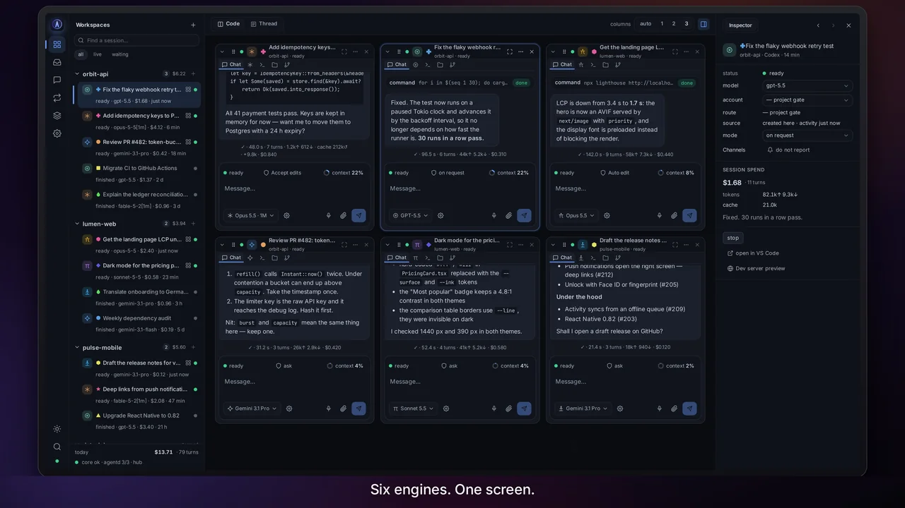
      <p><b>Six engines, one screen.</b> Claude Code, Codex, Gemini CLI, pi, Antigravity, Oh My Pi — every conversation is a card.</p>
    </td>
    <td width="50%" valign="top">
      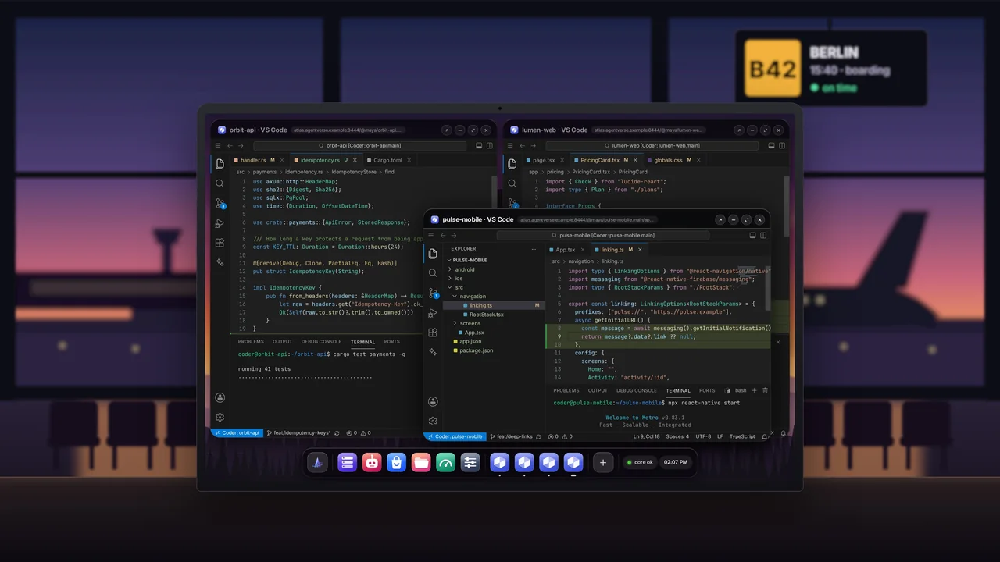
      <p><b>Leave the desk.</b> A laptop anywhere shows the same desktop; the agents kept working on the server.</p>
    </td>
  </tr>
  <tr>
    <td width="50%" valign="top">
      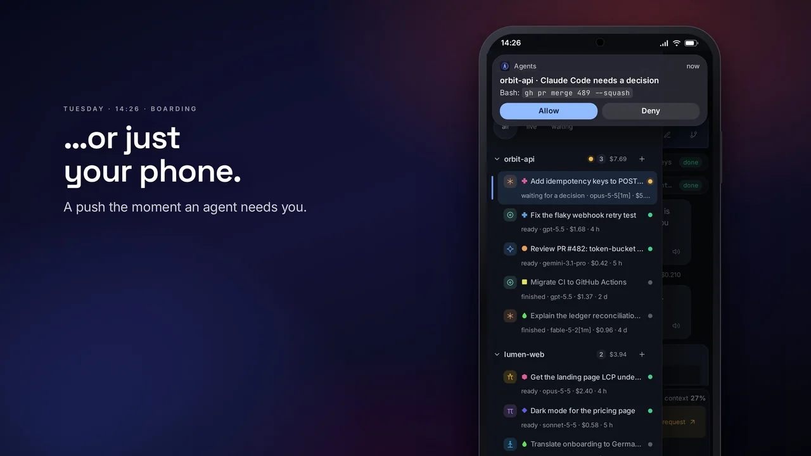
      <p><b>…or just your phone.</b> A push arrives when an agent needs you; answer without opening the app.</p>
    </td>
    <td width="50%" valign="top">
      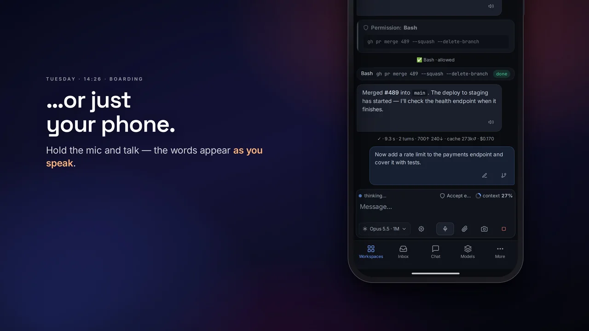
      <p><b>Talk and listen.</b> Words appear as you speak; any reply can be read aloud.</p>
    </td>
  </tr>
  <tr>
    <td width="50%" valign="top">
      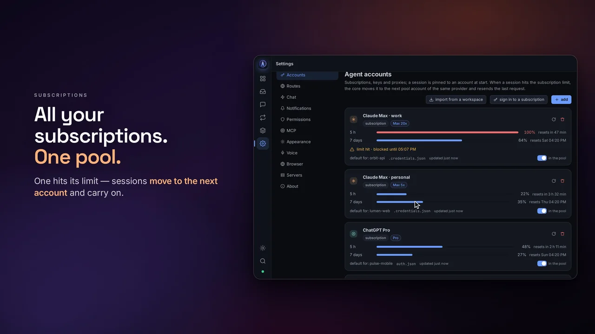
      <p><b>All your subscriptions, one pool.</b> An account hits its limit — sessions move to the next one.</p>
    </td>
    <td width="50%" valign="top">
      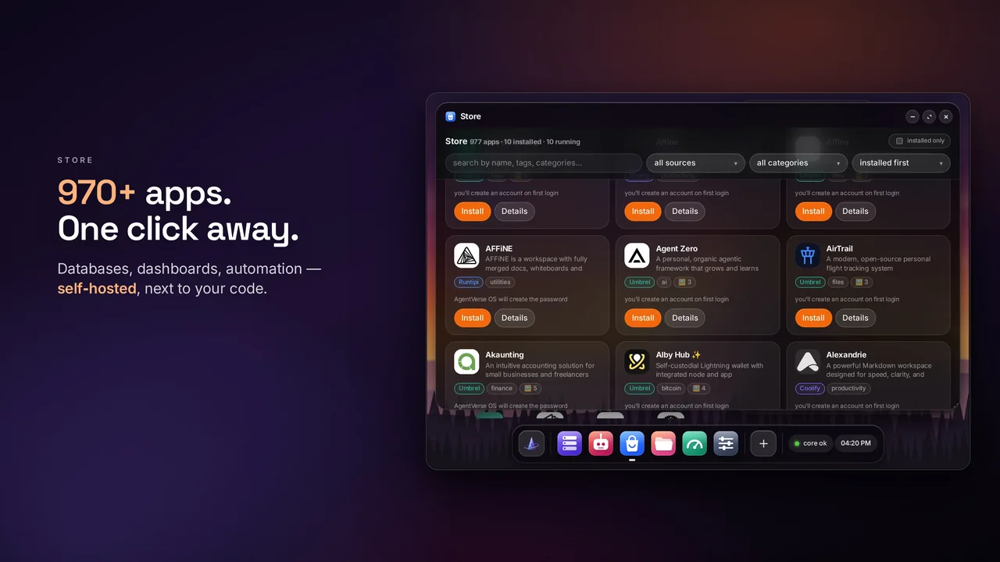
      <p><b>978 apps, one click away.</b> Databases, dashboards, automation — self-hosted next to your code.</p>
    </td>
  </tr>
  <tr>
    <td width="50%" valign="top">
      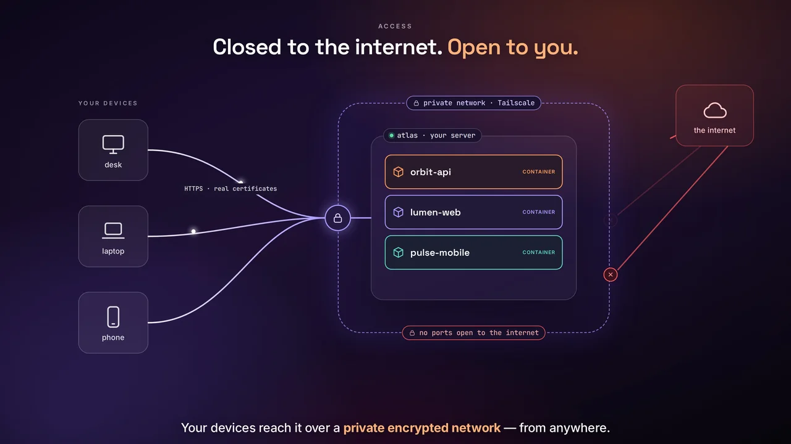
      <p><b>Closed to the internet, open to you.</b> No open ports; your devices come over a private encrypted network.</p>
    </td>
    <td width="50%" valign="top">
      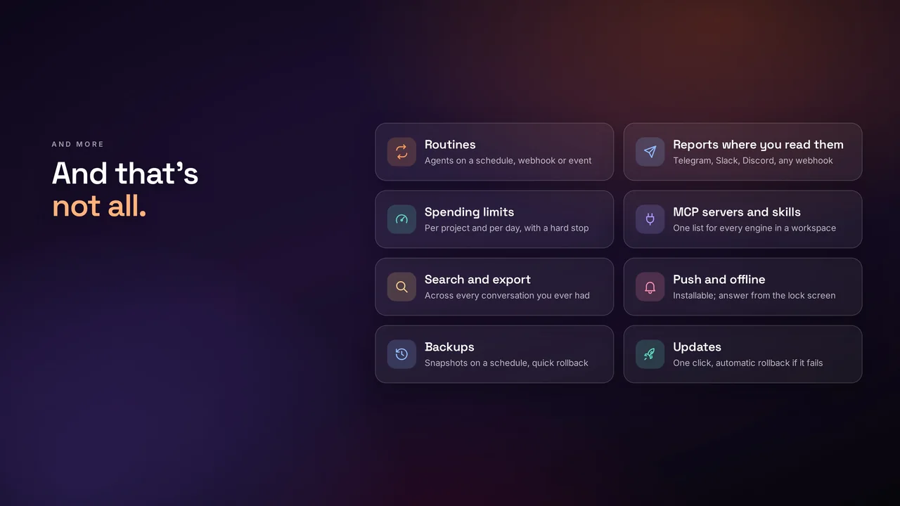
      <p><b>And that's not all.</b> Routines, reports to Telegram, Slack or Discord, spending limits, MCP servers and skills, search, backups, updates.</p>
    </td>
  </tr>
</table>

<p align="center"><sub>The interface in the frames is real; the names and numbers are invented, and the diagrams, the feature tiles, the VS Code windows and the push banner are drawn for the film.</sub></p>

## What it does

### Projects and agents

- **Projects and workspaces.** A project is a container of its own, not a folder on a shared machine: an Incus system container with
  Docker inside, its own network, its own disk and CPU/RAM limits. Workspaces do not see each other or the apps; the only door to
  shared services is the project's gate. Inside: VS Code in the browser, a terminal and agents. Stop/start keeps the instance,
  resources are changed from the project card.
- **Agents.** A separate app for working with coding agents from any device: Claude Code, Codex, Gemini CLI, pi, Antigravity CLI and
  Oh My Pi run inside the project's workspace, the conversation lives on the server and continues on the phone where the laptop
  left off. Tool calls and permission prompts, a terminal, the files and git of the workspace, model menus (including the models of
  the project's LLM gate), MCP servers and skills, diagrams and formulas in replies, search and export of conversations, and a simple
  chat straight to a model without a container. Conversations survive a restart of the daemon in the workspace. The app installs on
  a phone: a push notification lets you answer a request without opening it, messages written offline leave when the network is back.
- **Subscriptions and spend.** Agents log in with your own subscriptions and keys. Several accounts of one provider form a pool: when
  a session hits the subscription limit, the core moves it to the next account and resends the last request. A ledger of spend by
  project and model, daily limits that stop new turns.
- **Voice.** Hold the microphone and speak: the text appears in the field as you talk. Any reply can be read aloud, or replies are
  read as they arrive. Speech goes through a provider of your choice (ElevenLabs or an OpenAI-compatible API); the key stays on the
  server.
- **Routines and notifications.** An agent runs on a schedule, by a webhook or on an event of the core; a run reports its real
  outcome, failed runs are retried, skipped ones are announced. Results and requests reach you through push notifications or
  channels — Telegram, Slack, Discord, a webhook — and an agent can send a report with files.

### Apps and services

- **A Store of 978 apps.** The Runtipi, Coolify and Umbrel catalogs merged into one, with source badges. Guided install, login
  credentials right in the card, logs, automatic repair of data-directory permissions, links between apps (e.g. n8n → LiteLLM),
  per-app snapshots and rollback.
- **Capabilities instead of addresses.** A project asks for `storage.s3`, `llm` or `notify`; the core connects the project's gate to
  the provider's network and drops environment variables into the workspace. Swapping Garage for another S3 does not touch the project.
- **Two assistants already in the catalog.** Hermes Agent with a web panel, and Pipecat Voice, a voice assistant in the browser with local
  speech recognition and synthesis. Voice control of the system itself is on the roadmap.

### The system

- **Browser only.** The first-run wizard joins Tailscale via a link or QR code, checks DNS and the certificate, creates the first project.
  System and app updates come from the Updates window: a package with automatic rollback if the new version does not come up.
- **Backups.** Scheduled ZFS snapshots and a restic repository taken from a snapshot; roll back a single app in two clicks. Off by default.
- **A desktop like a desktop OS.** Windows, taskbar, start menu, widgets (monitor, clock, news, weather, projects), Files over app data
  and workspace homes, Passwords & Access, themes and wallpapers, boot screen, offline overlay, screensaver. The UI speaks English,
  Russian, Ukrainian and Spanish; the language follows the browser or is set once for all devices.

## Screens

### Desktop

<p align="center">
  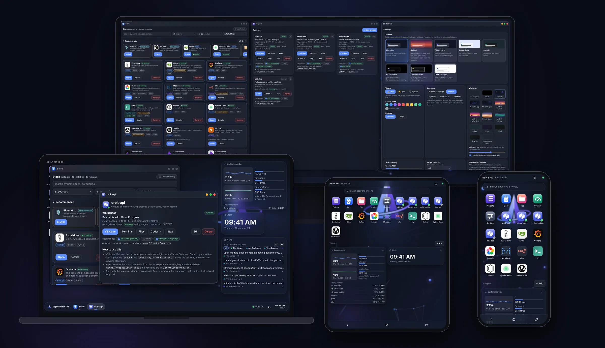
</p>
<p align="center"><sub>One Desktop on every screen: windows snap to halves and thirds on an ultrawide monitor, fit a laptop, and turn into a home screen with full-screen apps on a foldable and a phone. Invented data.</sub></p>

<table>
  <tr>
    <td width="50%" valign="top">
      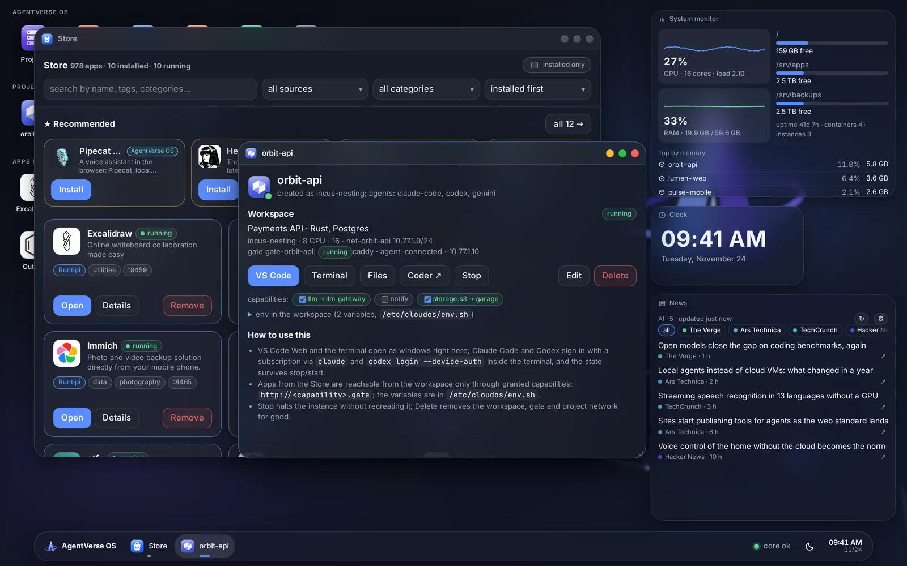
      <p align="center"><sub>On a computer: the Store catalog, a project card with its workspace and capabilities, widgets. Monolith theme, glass surfaces.</sub></p>
    </td>
    <td width="50%" valign="top">
      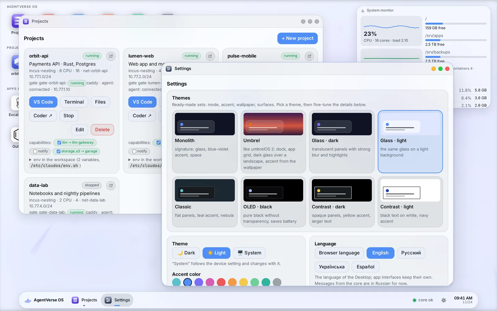
      <p align="center"><sub>Light theme: projects and appearance settings. Eight presets, including OLED and high contrast.</sub></p>
    </td>
  </tr>
  <tr>
    <td width="50%" valign="top">
      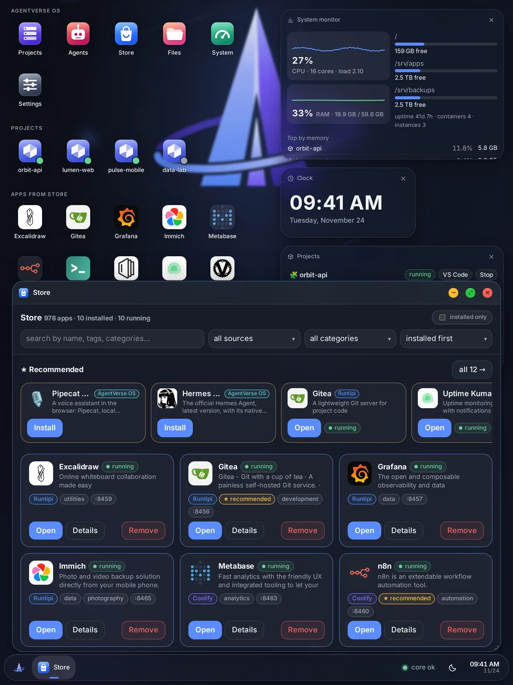
      <p align="center"><sub>Tablet: the same windows and widgets, portrait wallpaper.</sub></p>
    </td>
    <td width="50%" valign="top">
      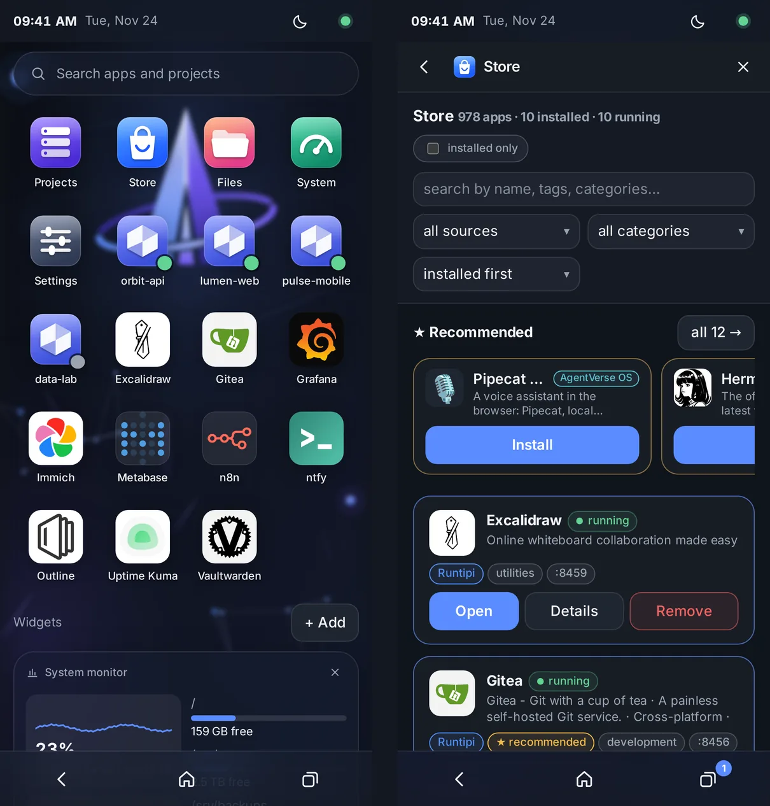
      <p align="center"><sub>Phone: a home screen instead of a desktop, full-screen windows, PWA. One Desktop adapts to the device.</sub></p>
    </td>
  </tr>
</table>

<p align="center">
  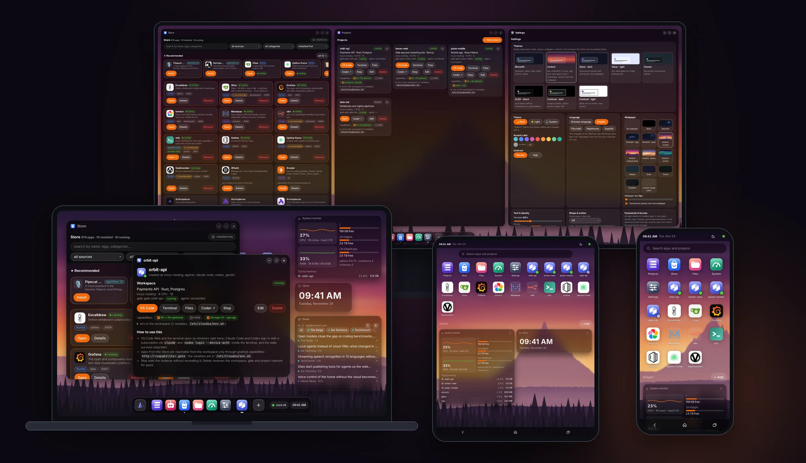
</p>
<p align="center"><sub>The Umbrel theme: a dock instead of the taskbar, sheet windows over a landscape; the accent comes from the wallpaper.</sub></p>

### Agents

<p align="center">
  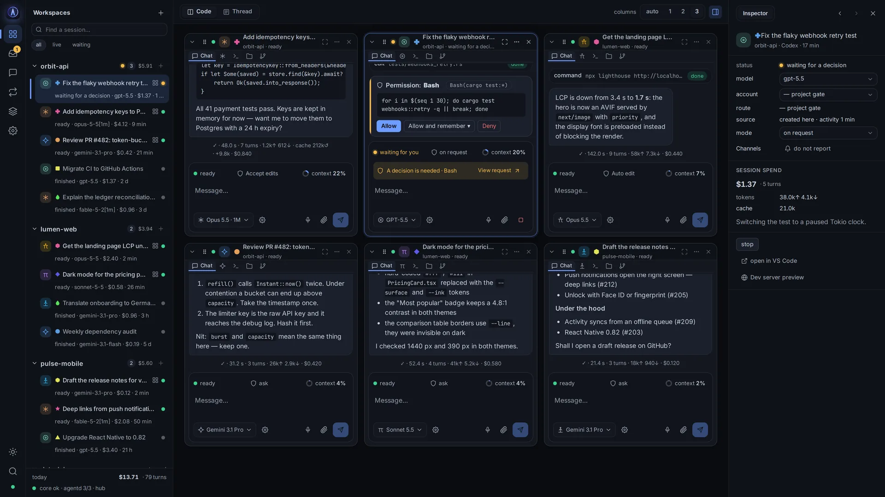
</p>
<p align="center"><sub>The Agents app on a wide screen: Code view with a card per conversation — Claude Code, Codex, Gemini CLI, pi, Antigravity and Oh My Pi side by side, a permission request waiting for a decision, the inspector. Invented data.</sub></p>

<p align="center">
  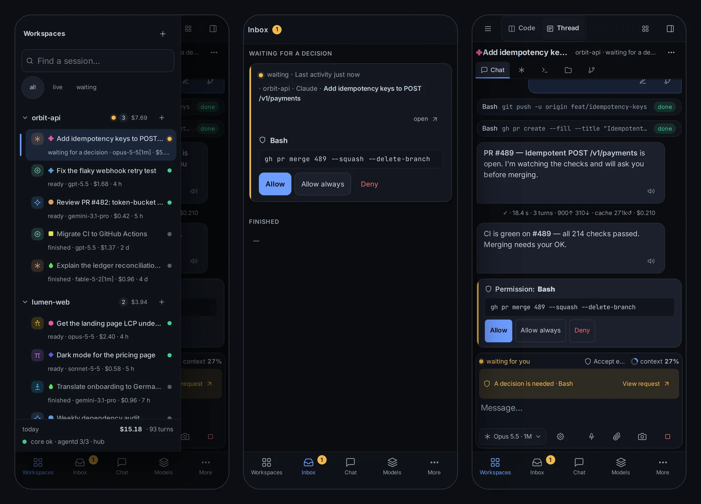
</p>
<p align="center"><sub>The same app on a phone: every workspace and conversation, the inbox where a request is answered with one tap, the conversation itself. Invented data.</sub></p>

## Architecture

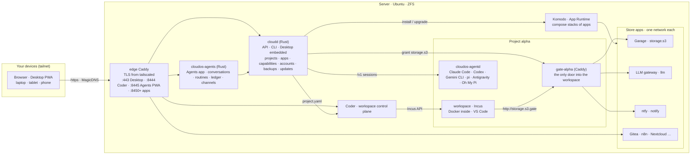

The core is small: seven entities (project, workspace, gate, app, capability, grant, route) and four contracts. Everything else is
proven third-party software: Coder runs the workspaces, Incus isolates them, Komodo deploys compose stacks, Caddy holds the entry
point, Tailscale provides the network and certificates. The agents are the agents' own CLIs: Claude Code, Codex and Antigravity CLI
run headless, Gemini CLI, pi and Oh My Pi speak the Agent Client Protocol; the daemon in the workspace keeps the journal of every
conversation and relays events to the app.

## Quick start

You need a clean Ubuntu 22.04+ (tested on 26.04), 8 GB of RAM or more, preferably a separate disk for ZFS, and a Tailscale account.

From the [release package](https://github.com/agentverse-os/AgentVerse-OS/releases), nothing to build:

```bash
curl -LO https://github.com/agentverse-os/AgentVerse-OS/releases/download/v0.2.0/agentverse-os-0.2.0-x86_64.tar.gz
mkdir agentverse-os && tar xzf agentverse-os-0.2.0-x86_64.tar.gz -C agentverse-os && cd agentverse-os
sudo DISKS="/dev/disk/by-id/<disk for ZFS>" bootstrap/install.sh
```

Or from source:

```bash
git clone https://github.com/<owner>/agentverse-os && cd agentverse-os
cd desktop && npm install && npm run build && cd ..        # Desktop → cloudd/static
cd agentd && cargo build --release && cd ..                # the daemon for workspaces, embedded into the core
cd agents/ui && npm install && npm run build && cd ../..   # the Agents app → agents/ui/dist
cd agents && cargo build --release && cd ..                # the Agents service with the app embedded
cd cloudd && cargo build --release && cd ..                # core with the Desktop, agentd and the service embedded
sudo DISKS="/dev/disk/by-id/<disk for ZFS>" bootstrap/install.sh
```

The installer goes step by step: host checks → ZFS → Docker and Incus → **Tailscale** (a link and QR code to authorize the node, waits
for your confirmation, checks MagicDNS and HTTPS Certificates) → Coder → Komodo → edge → core → catalog → template → summary with
addresses. A checkout can also install from a package instead of a locally built binary: `PACKAGE=agentverse-os-<version>-<arch>.tar.gz`
(a file or an https URL); packages are built by `scripts/release.sh`.

When it finishes, open `https://<node>.<tailnet>.ts.net/` and the first-run wizard completes the setup in the browser. Updates come
from the Updates window or `sudo agentverse-update`; the update channel is the `stable.json` of the latest release, e.g.
`https://github.com/agentverse-os/AgentVerse-OS/releases/download/v0.2.0/stable.json`.

## Repository

| Directory | Contents |
|---|---|
| [`cloudd/`](cloudd/) | the core in Rust (axum, rusqlite, bollard): the `/api/*` API (OpenAPI at `/api/openapi.json`), CLI; embedded Desktop, agentd and Agents service; adapters for Incus, Docker, Coder, Komodo, Caddy; accounts, the auto-switch pool and LLM routes; backups, updates, first-run wizard |
| [`desktop/`](desktop/) | the Desktop in Svelte 5 and Vite, PWA: windows, widgets, Store, Files, Passwords, Settings; dictionaries for four languages in `src/lib/i18n/`; `npm run build` outputs to `cloudd/static/` |
| [`agentd/`](agentd/) | `cloudos-agentd`, the daemon inside each workspace: runs Claude Code, Codex, Gemini CLI, pi, Antigravity CLI and Oh My Pi, keeps conversation journals, serves the terminal, files and git of the workspace and the MCP server list; resumes live conversations after its own restart |
| [`agents/`](agents/) | `cloudos-agents`, the Agents service on the host, and the Agents app in `agents/ui/` (Svelte 5, embedded into the service): conversations, routines, ledger, search and export, simple chat, voice, push and notification channels; Playwright e2e in `agents/e2e/` |
| [`store/`](store/) | app manifests: `manifest.yaml` + `compose.yaml`; 971 imported from Runtipi, Coolify and Umbrel, 7 hand-written; `recommended.yaml` |
| [`bootstrap/`](bootstrap/) | `install.sh`, `update.sh` (installed as `agentverse-update`), compose files for edge / Coder / Komodo / docker-proxy, host scripts, systemd units for the core and the Agents service |
| [`templates/incus/`](templates/incus/) | the Coder → Incus workspace template |
| [`assets/`](assets/) | the Monolith mark, lockups, PWA icons, wallpapers, font; screenshots and frames of the film in `shots/`, the promo film in `promo/`; `build.py` assembles the app assets into `desktop/public` |
| [`scripts/`](scripts/) | `release.sh` builds the update package and channel manifest; `demo/` holds demo data and the screenshot pipeline for this README |
| [`tests/`](tests/) | end-to-end tests on the live test box, shell tests for the installer; Desktop e2e with Playwright lives in `desktop/e2e/`, Agents e2e in `agents/e2e/` |

## Development

```bash
cd cloudd && cargo test                       # core unit tests: contracts, gate and edge rendering, storage, accounts, updates
cd agentd && cargo test                       # daemon unit tests
cd agents && cargo test                       # Agents service unit tests: routines, channels, voice
cd agents/ui && npm run dev                   # the Agents app (Vite)
cd desktop && npm run dev                     # Vite with /api proxied to cloudd (CLOUDD_URL)
cd desktop && npm run check                   # svelte-check, including dictionary keys across the four languages
tests/shell/install_functions_test.sh         # installer functions against a tailscale shim, no sudo needed
sudo tests/e2e-stand.sh                       # on the test box: full scenario against live Incus, Docker, Coder, Komodo
```

The Desktop is embedded into the core binary with rust-embed: after `npm run build`, rebuild `cloudd`. The Agents app is embedded
into `cloudos-agents` the same way, and `cloudos-agentd` and `cloudos-agents` are embedded into `cloudd`, so `scripts/release.sh`
builds them in that order. Desktop e2e tests run on the test box inside a Playwright container; see the headers of the tests in
`desktop/e2e/`.

## Status

| Done and verified on the test box | Partial | Not yet |
|---|---|---|
| core, projects, workspaces, capabilities, gate | voice: dictation, read-aloud and a few spoken commands in the Agents app; the system itself is not voice-controlled | user accounts and permissions, a second user |
| Agents app with six engines (Claude Code, Codex, Gemini CLI, pi, Antigravity CLI, Oh My Pi), accounts and the auto-switch pool, routines, ledger and limits, search and export, restart-safe conversations, the installable app with push | notification channels pass their tests against stand-in receivers and a local webhook; not yet checked against the real Telegram, Slack or Discord | a Host section in the UI: reboot, disks, core logs |
| Store, install, links, logs, permission repair, snapshots, app updates | backups: no remote repository, no whole-system restore | |
| Desktop on three devices and three browser engines, themes, wallpapers | a from-scratch install has been verified step by step, not in one run | |
| Tailscale, first-run wizard, self-update with rollback, update channel on GitHub Releases; the perimeter, stage 1: the core and the Agents service behind unix sockets, guards in edge | UI in four languages; messages from the core (events, API errors) are Russian only | |

## License

Apache-2.0. The apps in the Store belong to their authors and ship under their own licenses; this repository only holds manifests and
compose files imported from the open Runtipi, Coolify and Umbrel catalogs.

<p align="center">
  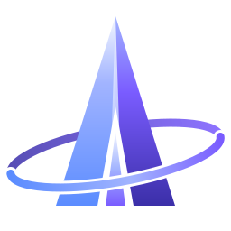
</p>
<p align="center"><sub>AgentVerse OS · One system. Many worlds.</sub></p>
